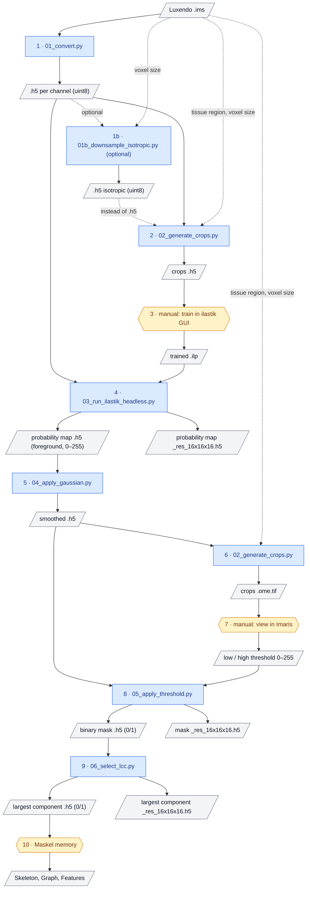

# Skeleton Pipeline

Input: reconstructed `.ims` file by Luxendo.

| Step | Script | Input | Output | What it does |
|---|---|---|---|---|
| 1 | `01_convert.py` | `.ims` | one 8-bit `.h5` per channel, `-meta.json` | Converts every channel to uint8, chunked, gzip-compressed `.h5` for ilastik |
| 1b (optional) | `01b_downsample_isotropic.py` | `.h5` (step 1), `.ims` | resampled `.h5` (uint8, with `element_size_um`), `-meta.json` | Resamples y and x to the z voxel size, slice by slice with `skimage.transform.resize` (anti-aliasing + linear interpolation): reads whole-plane slabs as deep as the input chunks, resizes their slices in parallel into an uncompressed `-tmp.npy` next to the output, then writes that as a compressed `.h5`. Axes not finer than z are left as they are. Later steps then use this `.h5` instead of the step 1 one |
| 2 | `02_generate_crops.py` | `.h5` (step 1 or 1b), `.ims` | crops (`.h5`), `meta.json`, overview `.png` | Cuts random crops (with voxel size) from the tissue region, for training ilastik |
| 3 | manual (ilastik GUI) | crops (step 2) | trained `.ilp` | Train the pixel classifier: label foreground / background |
| 4 | `03_run_ilastik_headless.py` | `.h5` (step 1), trained `.ilp` (step 3) | probability map `.h5` (uint8, z/y/x), `_res_16x16x16.h5` | Runs the trained pixel classifier headless on the full volume, plus a 16x downsampled copy |
| 5 | `04_apply_gaussian.py` | probability map `.h5` (step 4), sigma z/y/x | smoothed `.h5` (uint8), `-meta.json` | Smooths the probability map with a Gaussian (default sigma 0, 1.2, 1.2 voxels) |
| 6 | `02_generate_crops.py` | smoothed `.h5` (step 5), `.ims` | crops (`.ome.tif`), `meta.json`, overview `.png` | Cuts random crops (with voxel size) from the smoothed map, for viewing |
| 7 | manual (Imaris) | crops (step 6) | low / high threshold 0–255 | View the crops and decide on the two thresholds |
| 8 | `05_apply_threshold.py` | smoothed `.h5` (step 5), low / high (step 7) | binary mask `.h5` (0/1), `_res_16x16x16.h5`, `-meta.json` | Hysteresis threshold: keeps voxels > low connected to a voxel > high, plus a 16x downsampled copy |
| 9 | `06_select_lcc.py` | binary mask `.h5` (step 8), or its `_res_16x16x16.h5` | binary mask `.h5` (0/1), `_res_16x16x16.h5`, `-meta.json` | Keeps only the largest connected component (6 neighbours), plus a 16x downsampled copy |

`utils.py`: `downsample_h5()` (mean over 16×16×16 voxels), used by steps 4, 8 and 9; `voxel_size()` (from the `.ims` extent), used by steps 1b and 2.

