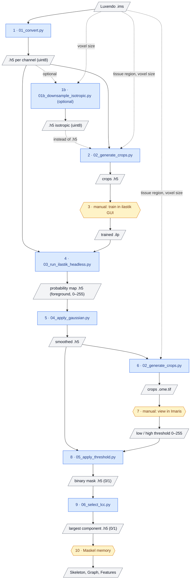

# Skeleton Pipeline

Input: reconstructed `.ims` file by Luxendo.

## GUI (orchestrator)

```
python -m orchestrator <project folder>
```

or, on Windows, `start_gui.bat <project folder>` (uses the Python of `.venv`, no need to activate it; drag a project
folder onto it, or double-click it and enter the folder; options such as `--port 8090` go after the folder).

Opens a browser tab (http://127.0.0.1:8080). A new, empty folder becomes a new project. In the GUI you can

- add samples (name, tag, the `.ims`, which is copied into the sample folder, and the structure each channel shows,
  e.g. Nerves, Blood vessels, Lymphatics), and edit the lists of tags and structures under *Settings*,
- process each channel on its own: a channel is an independent image with its own runs,
- branch: a step run with several settings (or again with other settings) from the same previous run splits the
  branch, and every branch continues on its own (the sample page shows them as a tree). The samples table has one
  row per channel with the furthest step done on it. Failed tries do not make branches,
- set parameters and queue the script steps of a branch (one run at a time); the inputs come from the runs before it
  on the branch. Running a step again with other settings makes another branch; runs never overwrite each other,
- follow the running job's log and progress under *Queue* (one job at a time),
- do the manual steps (ilastik training, Maskel) with instructions that show the actual paths, and record their
  result (`.ilp`, Maskel outputs). Choosing the thresholds is not a step of its own in the GUI: the threshold step
  shows the crops folder and takes low / high directly (so the GUI numbers the later steps 7 Hysteresis threshold,
  8 Largest connected component, 9 Maskel; their folders keep the names `08_threshold`, ...),
- import results made outside the GUI (*Import* on the samples page): for one channel of a sample, choose the file or
  folder each step produced (and its parameters, if known). They are copied or moved into new run folders under the
  names the later steps expect, as finished runs of a new branch (marked as imported, without log or command).

Jobs run in their own process: closing the GUI does not stop a running job, and queued jobs continue when the GUI is
started again. Options: `--port`, `--host 0.0.0.0` (reachable from other PCs), `--no-browser`.

Everything is stored in the project folder, so it stays readable without the GUI:

```
<project folder>/
    pipeline-project.json             project name, tags, structures
    samples/<sample>/
        sample.json                   name, tag, .ims path, notes, channels (index, name, structure)
        ims/<name>.ims                copy of the .ims and the files it links to, made when the sample is added
        channel<N>/<step>/<run>/      e.g. channel1/08_threshold/003_low40_high120/
            run.json                  channel, parent (the run it continues), parameters, inputs, status,
                                      command, timing, git commit of the scripts, results of manual steps, notes
            log.txt                   everything the script printed
            ...                       the outputs
```

The steps (inputs, parameters, commands, instructions of the manual steps) are defined in `orchestrator/steps.py`.

## Steps

The scripts are in `steps/`; each can also be run on its own, e.g. `python steps/04_apply_gaussian.py --help`.

| Step | Script | Input | Output | What it does |
|---|---|---|---|---|
| 1 | `01_convert.py` | `.ims` | one 8-bit `.h5` per channel, `-meta.json` | Converts every channel (or only those given with `--channel`; the GUI converts one channel per run) to uint8, chunked, gzip-compressed `.h5` for ilastik |
| 1b (optional) | `01b_downsample_isotropic.py` | `.h5` (step 1), `.ims` | resampled `.h5` (uint8, with `element_size_um`), `-meta.json` | Resamples y and x to the z voxel size, slice by slice with `skimage.transform.resize` (anti-aliasing + linear interpolation): reads whole-plane slabs as deep as the input chunks, resizes their slices in parallel into an uncompressed `-tmp.npy` next to the output, then writes that as a compressed `.h5`. Axes not finer than z are left as they are. Later steps then use this `.h5` instead of the step 1 one |
| 2 | `02_generate_crops.py` | `.h5` (step 1 or 1b), `.ims` | crops (`.h5`), `meta.json`, overview `.png` | Cuts random crops (with voxel size) from the tissue region, for training ilastik |
| 3 | manual (ilastik GUI) | crops (step 2) | trained `.ilp` | Train the pixel classifier: label foreground / background |
| 4 | `03_run_ilastik_headless.py` | `.h5` (step 1), trained `.ilp` (step 3) | probability map `.h5` (uint8, z/y/x) | Runs the trained pixel classifier headless on the full volume |
| 5 | `04_apply_gaussian.py` | probability map `.h5` (step 4), sigma z/y/x | smoothed `.h5` (uint8), `-meta.json` | Smooths the probability map with a Gaussian (default sigma 0, 1.2, 1.2 voxels) |
| 6 | `02_generate_crops.py` | smoothed `.h5` (step 5), `.ims` | crops (`.ome.tif`), `meta.json`, overview `.png` | Cuts random crops (with voxel size) from the smoothed map, for viewing |
| 7 | manual (Imaris) | crops (step 6) | low / high threshold 0–255 | View the crops and decide on the two thresholds |
| 8 | `05_apply_threshold.py` | smoothed `.h5` (step 5), low / high (step 7) | binary mask `.h5` (0/1), `-meta.json` | Hysteresis threshold: keeps voxels > low connected to a voxel > high |
| 9 | `06_select_lcc.py` | binary mask `.h5` (step 8) | binary mask `.h5` (0/1), `-meta.json` | Keeps only the largest connected component (6 neighbours) |

Every `.h5` volume the scripts write stores its voxel size (z, y, x) in µm in the `element_size_um` attribute of
its `data` dataset (as read by ilastik and Fiji): step 1 takes it from the `.ims`, later steps carry it over from
their input.

`steps/utils.py`: `downsample_h5()` (mean over 16×16×16 voxels, not used by the steps at the moment); `voxel_size()` (from the `.ims` extent), used by steps 1, 1b and 2; `read_voxel_size()`, used by step 4.



